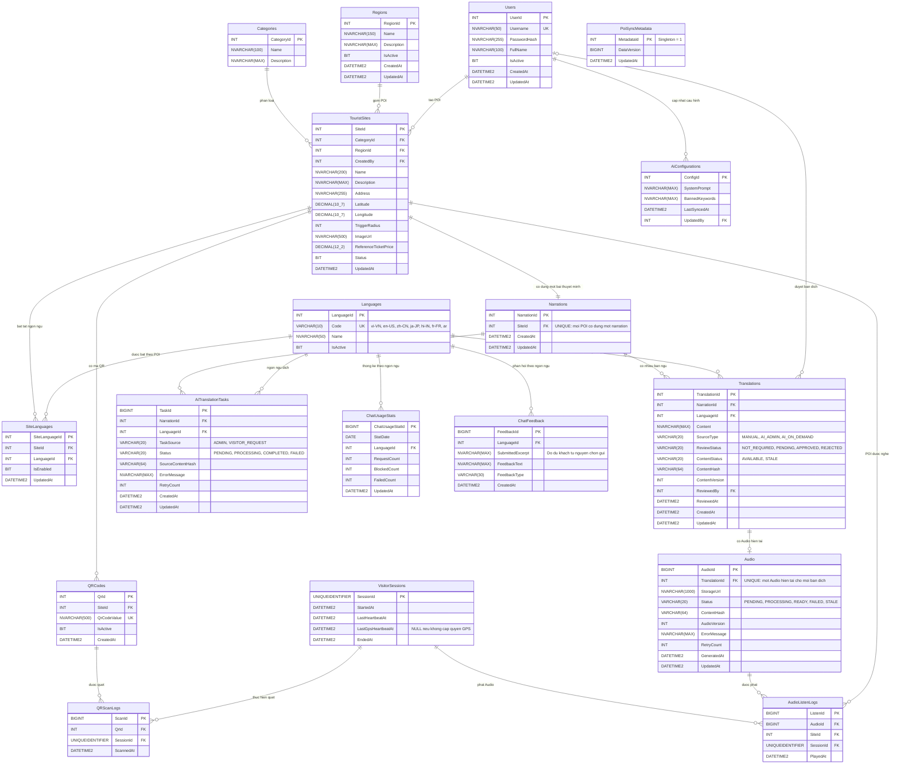

# ERD(2) – LinguaFlow

> Phiên bản cập nhật từ ERD(1), căn cứ theo PRD đã chốt, SRS và BFD.
> Đây là mô hình dữ liệu đề xuất. Các trạng thái và ràng buộc được ghi chú để thống nhất khi triển khai SQL Server.

## 1. Các thay đổi quan trọng so với ERD(1)

### 1.1. Phân khu là thực thể riêng

- Bổ sung `Regions`; mỗi POI thuộc một phân khu thông qua `TouristSites.RegionId`.
- `Categories` vẫn giữ vai trò phân loại địa điểm, không dùng để đại diện phân khu.
- Khi GPS xác định phân khu, Client có thể lấy toàn bộ POI thuộc `RegionId` đó để tìm các Audio cần tải.
- Khi quét QR, hệ thống tra QR ra POI rồi suy ra phân khu qua `TouristSites.RegionId`.
- Mô hình hiện tại giả định mỗi POI thuộc đúng một phân khu. Nếu sau này POI có thể nằm trong nhiều phân khu thì phải chuyển sang bảng liên kết `RegionSites`.

### 1.2. Narrations và Translations

- `Narrations` chỉ đại diện cho bài thuyết minh gắn với POI; `SiteId` phải có ràng buộc `UNIQUE` để bảo đảm một POI có đúng một bài.
- Không đặt `OriginalContent` tiếng Việt trực tiếp trong `Narrations`. Nội dung từng ngôn ngữ đều nằm trong `Translations`.
- Bản `vi-VN` và `en-US` có `SourceType = MANUAL`; nội dung do Super Admin biên soạn.
- Bản dịch quản trị do AI tạo có `SourceType = AI_ADMIN`, thường ở trạng thái `ReviewStatus = PENDING` cho đến khi được duyệt.
- Bản dịch phát sinh theo yêu cầu của du khách có `SourceType = AI_ON_DEMAND`; theo SRS(4), bản dịch tạo thành công được phép trả về ngay, không phải chờ Admin duyệt.
- `ContentHash` và `ContentVersion` dùng để nhận biết nội dung đã thay đổi và đối chiếu với Audio. Không nên cố định thuật toán hash là MD5 trong ERD; có thể chọn SHA-256 khi triển khai.

### 1.3. Audio tách khỏi Translations

- `Audio` là bảng riêng; một bản dịch có tối đa một bản Audio hiện tại.
- `Audio.Status` độc lập với `Translations.ReviewStatus` và `Translations.ContentStatus`.
- `StorageUrl` trỏ đến tệp trên vùng lưu trữ bền vững; SQL Server không lưu dữ liệu nhị phân.
- `Audio.ContentHash` phải khớp hash nội dung dùng để tạo Audio. Khi nội dung đổi, Audio cũ chuyển `STALE` hoặc được đánh dấu cần tạo lại; Client không được phát Audio stale.
- Chỉ Audio có `Status = READY` mới được đưa vào danh sách tải trước theo phân khu.
- `AudioVersion` giúp Client xác định tệp đã có trong cache có còn đúng phiên bản hay không.

### 1.4. Bật/tắt ngôn ngữ theo POI

- `SiteLanguages` biểu diễn ngôn ngữ được bật cho từng POI.
- Tạo unique constraint trên `(SiteId, LanguageId)` để không có hai cấu hình cho cùng một cặp POI/ngôn ngữ.
- Danh sách ngôn ngữ hệ thống gồm 7 mã khởi tạo: `vi-VN`, `en-US`, `zh-CN`, `ja-JP`, `hi-IN`, `fr-FR`, `ar`.
- Không nên suy ra `IsEnabled` chỉ từ việc có hay không có bản ghi `Translations`: cấu hình bật ngôn ngữ và tình trạng nội dung dịch là hai việc khác nhau.

### 1.5. Thống kê truy cập và quyền riêng tư

- `VisitorSessions` ghi nhận phiên truy cập ẩn danh, không cần tài khoản du khách.
- `LastHeartbeatAt` dùng để tính Online Visitors; `LastGpsHeartbeatAt` chỉ được cập nhật khi phiên đã cấp quyền GPS và thực sự gửi cập nhật vị trí. Phiên online không đồng nghĩa với phiên GPS.
- Không lưu tọa độ GPS hoặc lịch sử di chuyển trong bảng phiên.
- `QRScanLogs` và `AudioListenLogs` lưu sự kiện sử dụng cần cho thống kê lịch sử.
- `ChatUsageStats` chỉ lưu số liệu tổng hợp theo ngày và ngôn ngữ, không lưu nội dung câu hỏi/câu trả lời của mọi cuộc hội thoại.
- `ChatFeedback` chỉ lưu nội dung du khách chủ động chọn gửi sau khi xem lại và xác nhận. Không dùng bảng này làm nơi tự động lưu toàn bộ chat.

## 2. Ràng buộc cần triển khai ở SQL Server

1. `TouristSites.RegionId` là FK bắt buộc nếu mọi POI phải thuộc một phân khu.
2. `Narrations.SiteId` có `UNIQUE` và `NOT NULL`.
3. `Translations` có unique constraint `(NarrationId, LanguageId)`.
4. `SiteLanguages` có unique constraint `(SiteId, LanguageId)`.
5. `Audio.TranslationId` có `UNIQUE`; `Audio.TranslationId` phải tham chiếu một bản dịch tồn tại.
6. `ChatUsageStats` có unique constraint `(StatDate, LanguageId)` để cập nhật bộ đếm tổng hợp thay vì tạo nhiều dòng trùng ngày/ngôn ngữ.
7. `VisitorSessions.SessionId` là mã ngẫu nhiên khó đoán do Client tạo hoặc Server cấp; không dùng thông tin định danh cá nhân.
8. Các FK `ReviewedBy` và `UpdatedBy` phải tham chiếu `Users.UserId`.

## 3. Những điểm cần thống nhất khi chuyển sang thiết kế SQL/API

- **Một POI luôn có bài thuyết minh:** ERD dùng quan hệ 1–1 bắt buộc. Quy trình tạo POI và Narration nên nằm trong cùng transaction để không xuất hiện POI thiếu bài.
- **Bản dịch quản trị và bản dịch theo yêu cầu du khách:** `AiTranslationTasks.TaskSource` phân biệt hai luồng. Cần bảo đảm tác vụ `VISITOR_REQUEST` không bị chặn bởi quy trình duyệt Admin.
- **Audio dự phòng en-US:** việc chọn Audio dự phòng là logic nghiệp vụ/API. Không tạo bản ghi Audio của ngôn ngữ đang chọn trỏ nhầm sang file `en-US`; API phải trả rõ ngôn ngữ thực tế của nội dung và Audio dự phòng.
- **DataVersion:** chỉ tăng khi dữ liệu thuộc gói đồng bộ POI thay đổi theo quy tắc đã chốt. Việc TTS tạo xong, Audio đổi trạng thái hoặc file Audio được tạo lại không tự làm tăng DataVersion.
- **Heartbeat:** ngưỡng phiên còn hoạt động là cấu hình phía Server theo SRS(4), không đóng đinh một số giây trong ERD.
- **Chat statistics:** việc ghi `ChatUsageStats` cần cơ chế cộng dồn an toàn khi có nhiều request đồng thời; có thể cập nhật bằng transaction/upsert hoặc tổng hợp từ bộ đếm sự kiện nội bộ mà không lưu nội dung chat.

## 4. Phạm vi chưa mô hình hóa

ERD(2) chưa thêm bảng cho lịch sử phiên bản nội dung, lịch sử nhiều file Audio cũ, hàng đợi TTS tổng quát, lưu trữ file ảnh, hay lịch sử vị trí GPS. Đây là các thành phần chỉ nên bổ sung khi PRD/SRS hoặc yêu cầu triển khai xác định rõ nhu cầu. Bản ERD này tập trung vào dữ liệu nghiệp vụ và thống kê đã có căn cứ trong tài liệu hiện tại.
