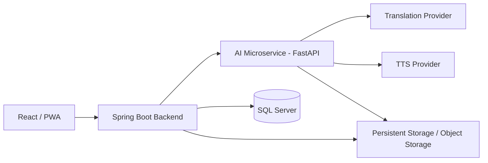

# LinguaFlow AI Microservice Setup

> **Phiên bản đề xuất:** 2  
> **Trạng thái:** đã được duyệt, có thể thêm trong tương lai
> **Phạm vi:** Hướng dẫn chạy AI Microservice và hợp đồng giao tiếp giữa Spring Boot Backend với dịch vụ AI.  
> **Nguyên tắc:** Spring Boot là nơi điều phối nghiệp vụ và quản lý dữ liệu. AI Microservice chỉ thực hiện các tác vụ AI được yêu cầu; không tự quyết định trạng thái duyệt bản dịch, không tự cập nhật DataVersion và không truy cập trực tiếp database của LinguaFlow.

---

## 1. Kiến trúc tổng quan

LinguaFlow sử dụng một AI Microservice độc lập viết bằng Python/FastAPI. Spring Boot Backend gọi Microservice qua HTTP để thực hiện dịch thuật và chuyển văn bản thành giọng nói (Text-to-Speech - TTS).

### 1.1. Thành phần

| Thành phần              | Trách nhiệm                                                                                                                                                                         |
| ----------------------- | ----------------------------------------------------------------------------------------------------------------------------------------------------------------------------------- |
| `backend` (Spring Boot) | Điều phối nghiệp vụ; xác định nội dung và ngôn ngữ nguồn/đích; quản lý `Translations`, `AiTranslationTasks`, `Audio`; quyết định trạng thái duyệt; lưu metadata và đường dẫn Audio. |
| `ai-service/main.py`    | Khởi chạy FastAPI và đăng ký các endpoint AI.                                                                                                                                       |
| Translation adapter     | Gọi nhà cung cấp dịch thuật được cấu hình để dịch văn bản.                                                                                                                          |
| TTS adapter             | Gọi nhà cung cấp TTS được cấu hình để tạo tệp âm thanh.                                                                                                                             |
| Storage adapter         | Lưu tệp Audio vào vùng lưu trữ bền vững bên ngoài gói triển khai ứng dụng và trả về định danh/đường dẫn lưu trữ.                                                                    |

AI Microservice **không**:

- Kết nối trực tiếp hoặc tự ghi dữ liệu vào SQL Server.
- Tự tạo hoặc duyệt bản ghi `Translations`.
- Tự quyết định ngôn ngữ nào được bật cho một POI.
- Tự tăng `DataVersion`.
- Nhận hoặc lưu toàn bộ lịch sử hội thoại chatbot của khách.

### 1.2. Sơ đồ luồng tổng quát



---

## 2. Cấu trúc thư mục tham khảo

```text
LinguaFlow/
├── backend/
│   └── ...
├── frontend/
│   └── ...
└── ai-service/
    ├── main.py
    ├── requirements.txt
    ├── .env.example
    └── app/
        ├── api/
        │   └── routes.py
        ├── schemas/
        │   ├── translation.py
        │   └── tts.py
        ├── providers/
        │   ├── translation_provider.py
        │   └── tts_provider.py
        └── storage/
            └── audio_storage.py
```

Đây là cấu trúc tham khảo để tách API, schema, provider và lưu trữ. Có thể điều chỉnh tên/thư mục khi triển khai nhưng không được làm thay đổi trách nhiệm giữa Backend và AI Microservice.

---

## 3. Ngôn ngữ và quy tắc dịch thuật

### 3.1. Mã ngôn ngữ

Sử dụng language code thống nhất với dữ liệu `Languages` của hệ thống:

| Ngôn ngữ                        | Language code | Nguồn nội dung                                         |
| ------------------------------- | ------------- | ------------------------------------------------------ |
| Tiếng Việt                      | `vi-VN`       | Super Admin tự biên soạn                               |
| Tiếng Anh (Mỹ)                  | `en-US`       | Super Admin tự biên soạn; nguồn trung gian cho AI dịch |
| Tiếng Trung giản thể            | `zh-CN`       | AI dịch từ `en-US`                                     |
| Tiếng Nhật                      | `ja-JP`       | AI dịch từ `en-US`                                     |
| Tiếng Hindi                     | `hi-IN`       | AI dịch từ `en-US`                                     |
| Tiếng Pháp                      | `fr-FR`       | AI dịch từ `en-US`                                     |
| Tiếng Ả Rập hiện đại tiêu chuẩn | `ar`          | AI dịch từ `en-US`                                     |

Danh sách trên là các ngôn ngữ ban đầu. Backend phải kiểm tra ngôn ngữ đích có tồn tại và được bật cho POI tương ứng trước khi tạo tác vụ dịch trong luồng quản trị.

### 3.2. Quy tắc nguồn dịch

- Nội dung tiếng Việt và tiếng Anh được Super Admin nhập/biên soạn thủ công.
- AI không dịch tiếng Việt sang tiếng Anh để tạo nội dung tiếng Anh chuẩn của POI.
- Với các ngôn ngữ dịch bằng AI, nguồn dịch là nội dung `en-US`.
- AI Microservice chỉ nhận `sourceLanguageCode` và `targetLanguageCode` do Backend gửi; không tự suy đoán hoặc thay đổi ngôn ngữ nguồn.
- Không dịch lại nội dung nếu Backend không yêu cầu.

### 3.3. Hai luồng sử dụng dịch thuật

**Luồng quản trị nội dung**

1. Super Admin cung cấp nội dung thủ công `vi-VN` và `en-US`.
2. Backend tạo `AiTranslationTasks` cho các ngôn ngữ AI được bật.
3. Backend gọi AI Microservice để dịch từ `en-US`.
4. Backend lưu kết quả vào `Translations` với nguồn `AI_ADMIN` và trạng thái chờ duyệt.
5. Super Admin xem, chỉnh sửa và duyệt bản dịch. Chỉ bản dịch được duyệt mới đủ điều kiện đi tiếp vào quy trình TTS/xuất bản theo quy tắc nghiệp vụ.

**Luồng khách yêu cầu bản dịch chưa có**

1. Khách chọn ngôn ngữ nhưng POI chưa có bản dịch tương ứng.
2. Backend yêu cầu AI Microservice dịch từ `en-US`.
3. Khi dịch thành công, Backend lưu bản dịch với nguồn `AI_ON_DEMAND` và có thể trả nội dung vừa dịch ngay cho khách theo quy tắc đã thống nhất.
4. Nếu dịch thất bại, Backend trả nội dung `en-US` làm phương án dự phòng.
5. Luồng này không được nhập chung với quy trình dịch thuật quản trị cần Super Admin duyệt.

AI Microservice chỉ thực hiện việc dịch và trả kết quả. Việc lưu, phân loại `SourceType`, cập nhật `ReviewStatus` và áp dụng fallback thuộc trách nhiệm của Backend.

---

## 4. API nội bộ của AI Microservice

Base URL khi chạy local:

```text
http://localhost:8000
```

Các endpoint dưới đây là API nội bộ giữa Spring Boot Backend và AI Microservice, không phải API công khai cho Frontend gọi trực tiếp.

### 4.1. Health check

`GET /health`

Response `200 OK`:

```json
{
  "status": "UP"
}
```

Endpoint này dùng để kiểm tra tiến trình AI Microservice đang hoạt động. Nó không đảm bảo tất cả nhà cung cấp AI hoặc dịch vụ lưu trữ bên ngoài đều đang hoạt động.

### 4.2. Dịch thuật

`POST /api/translate`

Request:

```json
{
  "text": "The Independence Palace is a historical landmark in Ho Chi Minh City.",
  "sourceLanguageCode": "en-US",
  "targetLanguageCode": "ja-JP"
}
```

Response `200 OK`:

```json
{
  "translatedText": "ホーチミン市にある統一会堂は、歴史的なランドマークです。",
  "sourceLanguageCode": "en-US",
  "targetLanguageCode": "ja-JP"
}
```

Quy tắc:

- `text` không được rỗng.
- Hai language code phải được gửi tường minh.
- Microservice không tự lưu bản dịch vào SQL Server.
- Nếu nhà cung cấp dịch thuật lỗi hoặc không hỗ trợ cặp ngôn ngữ, Microservice trả lỗi phù hợp; Backend quyết định retry, cập nhật task và fallback.
- Không trả về một chuỗi giả lập như thể dịch thành công khi nhà cung cấp thất bại.

### 4.3. Text-to-Speech

`POST /api/tts`

Request:

```json
{
  "text": "The Independence Palace is a historical landmark in Ho Chi Minh City.",
  "languageCode": "en-US",
  "contentHash": "sha256-content-hash",
  "audioFormat": "mp3"
}
```

Response `200 OK`:

```json
{
  "storageKey": "audio/site-1/en-US/sha256-content-hash.mp3",
  "storageUrl": "https://storage.example/audio/site-1/en-US/sha256-content-hash.mp3",
  "contentHash": "sha256-content-hash",
  "audioFormat": "mp3"
}
```

Quy tắc:

- `languageCode` xác định ngôn ngữ/giọng đọc được yêu cầu.
- `contentHash` đại diện cho phiên bản nội dung đầu vào do Backend tính và gửi sang.
- Microservice tạo Audio từ đúng nội dung nhận được; không tự lấy nội dung khác từ database.
- Chỉ trả thành công sau khi tệp đã được lưu thành công vào vùng lưu trữ bền vững.
- `storageKey` là định danh lưu trữ. `storageUrl` có thể là URL truy cập hoặc URL do hệ thống lưu trữ cấp; không giả định URL luôn công khai.
- Nếu hệ thống lưu trữ dùng URL ký có thời hạn, Backend cần cơ chế lấy URL truy cập mới khi cần. Không coi URL ký tạm thời là định danh lâu dài của Audio.
- Backend lưu metadata vào bảng `Audio`, gồm `TranslationId`, `StorageUrl`/định danh lưu trữ, `ContentHash`, `AudioVersion`, `Status` và các thông tin lỗi phù hợp.
- Nếu nội dung thay đổi, Backend phải coi Audio có hash cũ là lỗi thời và không phục vụ nó như Audio của nội dung mới.

### 4.4. Quy ước lỗi

Microservice nên trả lỗi có cấu trúc nhất quán. Ví dụ:

```json
{
  "errorCode": "TRANSLATION_PROVIDER_UNAVAILABLE",
  "message": "Translation provider is temporarily unavailable."
}
```

Các mã lỗi tối thiểu có thể dùng:

| Mã lỗi                             | Ý nghĩa                                         |
| ---------------------------------- | ----------------------------------------------- |
| `VALIDATION_ERROR`                 | Request thiếu hoặc sai dữ liệu                  |
| `UNSUPPORTED_LANGUAGE`             | Nhà cung cấp không hỗ trợ ngôn ngữ/cặp ngôn ngữ |
| `TRANSLATION_PROVIDER_UNAVAILABLE` | Nhà cung cấp dịch thuật tạm thời không khả dụng |
| `TTS_PROVIDER_UNAVAILABLE`         | Nhà cung cấp TTS tạm thời không khả dụng        |
| `AUDIO_STORAGE_FAILED`             | Không lưu được tệp Audio                        |
| `INTERNAL_ERROR`                   | Lỗi nội bộ không xác định                       |

HTTP status gợi ý:

- `400 Bad Request`: dữ liệu đầu vào không hợp lệ.
- `422 Unprocessable Entity`: ngôn ngữ hoặc nội dung không được hỗ trợ.
- `502 Bad Gateway`: nhà cung cấp bên ngoài trả lỗi hoặc phản hồi không hợp lệ.
- `503 Service Unavailable`: nhà cung cấp/dịch vụ lưu trữ tạm thời không khả dụng.
- `500 Internal Server Error`: lỗi nội bộ của Microservice.

Không đưa API key, access token, stack trace hoặc thông tin bí mật vào response trả về Backend.

---

## 5. Lưu trữ Audio

### 5.1. Nguyên tắc

- Không lưu MP3 được tạo trong `backend/src/main/resources/static/audio/` hoặc bên trong JAR/WAR của Spring Boot.
- Audio phải nằm trong vùng lưu trữ bền vững, độc lập với vòng đời triển khai Backend và AI Microservice.
- Có thể triển khai bằng persistent disk bên ngoài ứng dụng hoặc Object Storage. Nhà cung cấp cụ thể được cấu hình sau; tài liệu này không khóa dự án vào một nhà cung cấp.
- SQL Server chỉ lưu metadata và định danh/đường dẫn Audio, không lưu binary MP3.
- Backend chịu trách nhiệm liên kết Audio với `TranslationId` và quản lý trạng thái trong database.

### 5.2. Đặt tên và chống tạo trùng

Nên tạo đường dẫn dựa trên định danh POI, ngôn ngữ và hash nội dung, ví dụ:

```text
audio/{siteId}/{languageCode}/{contentHash}.mp3
```

Nếu cùng một nội dung và cùng một ngôn ngữ được yêu cầu lại, Storage adapter có thể kiểm tra đối tượng đã tồn tại để tránh tạo tệp trùng. Việc tái sử dụng chỉ hợp lệ khi `contentHash`, ngôn ngữ và cấu hình giọng đọc tương ứng đều khớp.

### 5.3. Không đồng nhất Audio với gói đồng bộ POI ban đầu

- Gói POI đồng bộ ban đầu không chứa toàn bộ Audio của mọi POI.
- Khi Client xác định được Region bằng GPS hoặc QR, Backend cung cấp danh sách Audio thuộc Region đó theo ngôn ngữ thuyết minh khách đã chọn.
- Client tải các Audio còn thiếu hoặc lỗi thời và lưu cache cục bộ.
- AI Microservice chỉ tạo tệp Audio; việc xác định Region, chọn danh sách Audio cần tải và quản lý cache thuộc Backend/Client theo API Contract.

---

## 6. Trạng thái và trách nhiệm xử lý bất đồng bộ

Translation và Audio có trạng thái độc lập.

| Thành phần                   | Trạng thái quản lý tại Backend                      | Ghi chú                               |
| ---------------------------- | --------------------------------------------------- | ------------------------------------- |
| `AiTranslationTasks`         | `PENDING`, `PROCESSING`, `COMPLETED`, `FAILED`      | Theo dõi tác vụ dịch                  |
| `Translations.ReviewStatus`  | `NOT_REQUIRED`, `PENDING`, `APPROVED`, `REJECTED`   | Theo dõi quy trình duyệt              |
| `Translations.ContentStatus` | `AVAILABLE`, `STALE`                                | Theo dõi tính hợp lệ của nội dung     |
| `Audio.Status`               | `PENDING`, `PROCESSING`, `READY`, `FAILED`, `STALE` | Theo dõi TTS và tính hợp lệ của Audio |

Nguyên tắc:

- Dịch thành công không có nghĩa là TTS đã thành công.
- TTS thất bại không làm bản dịch tự động chuyển thành thất bại.
- Backend cập nhật từng trạng thái độc lập.
- TTS có thể chạy bất đồng bộ thông qua worker/queue của Backend.
- Khi nội dung Translation thay đổi, Backend phải kiểm tra hash và đánh dấu Audio cũ là `STALE` nếu không còn khớp.
- TTS chỉ được tạo cho nội dung đủ điều kiện theo luồng nghiệp vụ tương ứng.
- Tạo hoặc cập nhật trạng thái Audio đơn thuần không làm tăng `DataVersion`, trừ khi có thay đổi thực sự trong dữ liệu thuộc gói POI sync theo quy tắc của PRD.

AI Microservice không tự quản lý các trạng thái database này; nó chỉ trả kết quả thành công hoặc lỗi của từng yêu cầu.

---

## 7. Cấu hình và chạy local

### 7.1. Tạo môi trường Python

Từ thư mục gốc repository:

```powershell
python -m venv ai-service/.venv
ai-service/.venv/Scripts/Activate.ps1
python -m pip install -r ai-service/requirements.txt
```

Nếu PowerShell không cho phép kích hoạt script, có thể chạy trực tiếp Python trong virtual environment:

```powershell
ai-service/.venv/Scripts/python.exe -m pip install -r ai-service/requirements.txt
```

### 7.2. Chạy FastAPI

```powershell
ai-service/.venv/Scripts/python.exe -m uvicorn main:app --app-dir ai-service --host 0.0.0.0 --port 8000
```

Mở:

```text
http://localhost:8000/health
```

để kiểm tra health check.

### 7.3. Cấu hình môi trường

Thông tin cấu hình nhạy cảm phải được đưa vào biến môi trường hoặc secret manager, không hardcode trong source code và không commit `.env` chứa API key.

Ví dụ `.env.example` (chỉ chứa placeholder):

```dotenv
AI_SERVICE_HOST=0.0.0.0
AI_SERVICE_PORT=8000

TRANSLATION_PROVIDER=google
TTS_PROVIDER=edge

AUDIO_STORAGE_PROVIDER=filesystem
AUDIO_STORAGE_ROOT=./data/audio
AUDIO_PUBLIC_BASE_URL=http://localhost:8000/audio
```

Các giá trị trên là cấu hình minh họa. Khi triển khai thật:

- `AUDIO_STORAGE_ROOT` phải trỏ tới persistent volume bên ngoài thư mục source/build artifact.
- Nếu dùng Object Storage, cấu hình endpoint, bucket và credentials bằng biến môi trường/secret; không ghi credentials vào repository.
- URL nội bộ của AI Microservice và URL truy cập Audio từ Client là hai khái niệm khác nhau, cần cấu hình riêng.

### 7.4. Chạy Backend và AI Microservice

Spring Boot Backend và Python AI Microservice chạy như hai tiến trình/dịch vụ riêng. Backend gọi các endpoint nội bộ của AI Microservice qua base URL cấu hình, không hardcode `localhost` trong môi trường triển khai nhiều container/máy chủ.

---

## 8. Retry, timeout và khả năng phục hồi

- Spring Boot Backend là nơi điều phối retry bằng Resilience4j cho các lỗi tạm thời khi gọi AI Microservice.
- Cần cấu hình timeout riêng cho dịch thuật và TTS; không để request treo vô hạn.
- Chỉ retry các lỗi có khả năng tạm thời như timeout, HTTP 502/503 hoặc lỗi kết nối.
- Không retry vô hạn với lỗi validation hoặc ngôn ngữ không hỗ trợ.
- Các request TTS nên có tính idempotent dựa trên `contentHash`, `languageCode` và cấu hình giọng đọc để hạn chế tạo trùng Audio.
- Khi retry hết số lần cấu hình, Backend cập nhật task/Audio tương ứng thành `FAILED`, lưu thông tin lỗi phù hợp và cho phép cơ chế retry lại theo nghiệp vụ.
- AI Microservice không được trả kết quả thành công giả khi provider hoặc storage thất bại.

---

## 9. Bảo mật và vận hành

- Chỉ Backend được phép gọi các endpoint nội bộ của AI Microservice trong môi trường triển khai.
- Không để API key của nhà cung cấp AI xuất hiện ở Frontend.
- Không ghi nội dung nhạy cảm, credentials hoặc token vào log.
- Giới hạn kích thước request và thời gian xử lý để tránh request quá lớn hoặc kéo dài bất thường.
- Có thể bổ sung service-to-service authentication khi triển khai trên môi trường có mạng truy cập rộng.
- Health check không được trả về credentials hoặc cấu hình bí mật.
- Log cần có request/correlation ID để truy vết lỗi giữa Backend và AI Microservice; tránh log toàn bộ nội dung khách gửi nếu không cần thiết.

---

## 10. Phạm vi chưa khóa

Các lựa chọn sau chưa được tài liệu nền chốt thành một nhà cung cấp/công nghệ cụ thể, vì vậy không nên tự coi chúng là quyết định cuối cùng:

1. Nhà cung cấp dịch thuật chính thức và phương án dự phòng.
2. Nhà cung cấp TTS chính thức, danh sách voice cụ thể cho từng ngôn ngữ.
3. Dùng persistent disk hay Object Storage; nếu dùng Object Storage thì chọn nhà cung cấp nào.
4. Cơ chế cấp URL truy cập Audio (URL công khai, URL ký có thời hạn hay qua Backend).
5. Cơ chế hàng đợi/worker cụ thể cho các tác vụ TTS.

Có thể giữ `deep-translator` và `edge-tts` làm adapter thử nghiệm ban đầu nếu phù hợp môi trường triển khai, nhưng cần kiểm tra điều khoản sử dụng, độ ổn định, giới hạn và khả năng hỗ trợ ngôn ngữ trước khi coi chúng là lựa chọn production.

---

## 11. Checklist trước khi triển khai

- [ ] Mã ngôn ngữ sử dụng thống nhất với bảng `Languages`.
- [ ] Dịch thuật AI dùng `en-US` làm nguồn cho các ngôn ngữ đích.
- [ ] Hai luồng `AI_ADMIN` và `AI_ON_DEMAND` được Backend xử lý riêng.
- [ ] AI Microservice không kết nối trực tiếp SQL Server.
- [ ] Translation và Audio có trạng thái độc lập.
- [ ] Tệp Audio được lưu ngoài JAR/WAR và có tính bền vững.
- [ ] Backend lưu metadata Audio và kiểm tra `ContentHash`.
- [ ] Audio cũ không được phục vụ sau khi nội dung nguồn thay đổi.
- [ ] Có timeout, retry có giới hạn và xử lý lỗi rõ ràng.
- [ ] API key/credentials không nằm trong source code hoặc Git.
- [ ] Luồng tải Audio theo Region được thực hiện qua Backend API, không nhúng toàn bộ Audio vào gói POI sync ban đầu.
