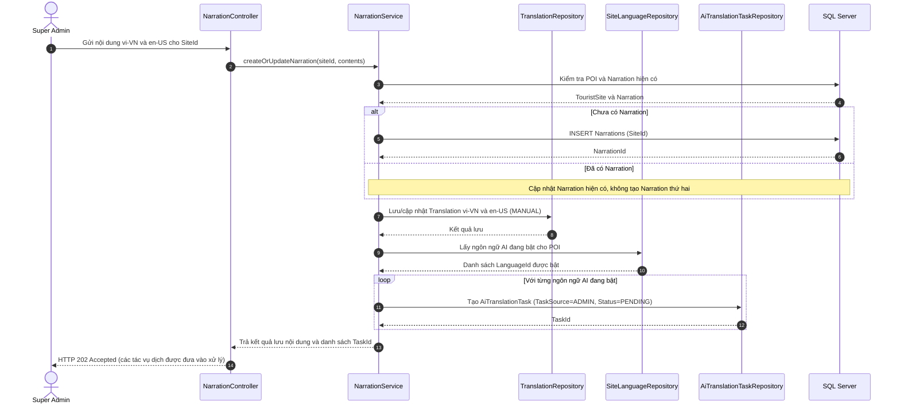
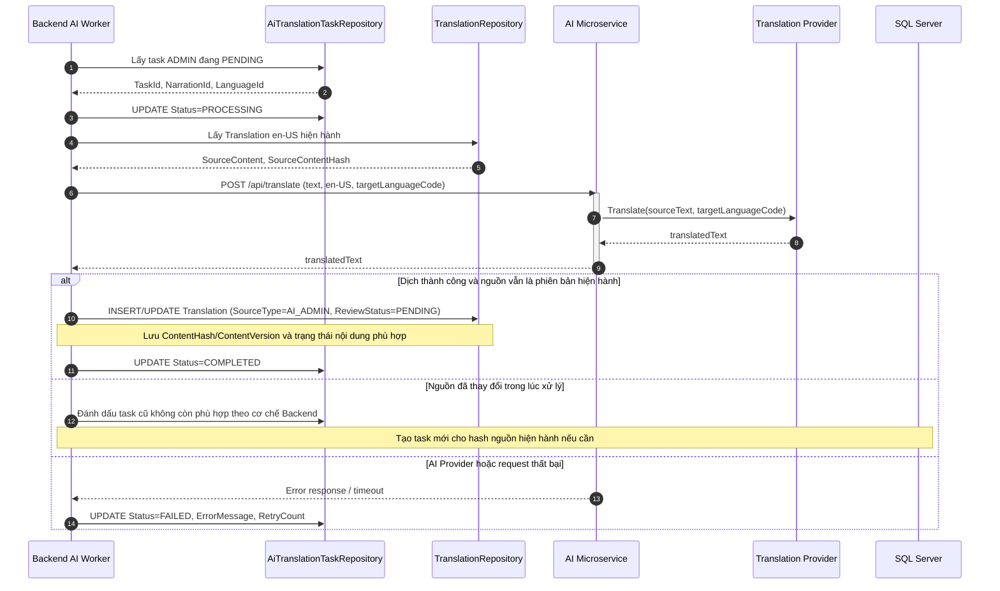
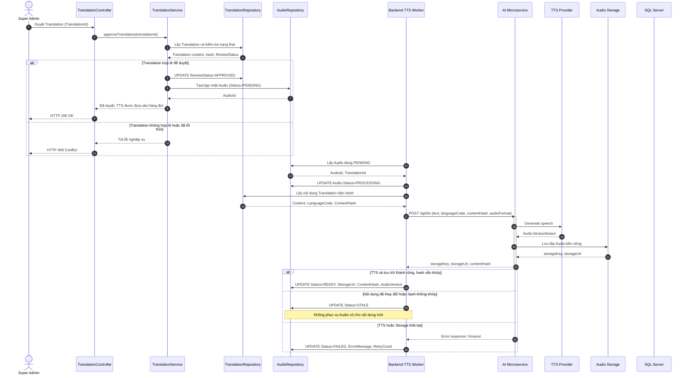
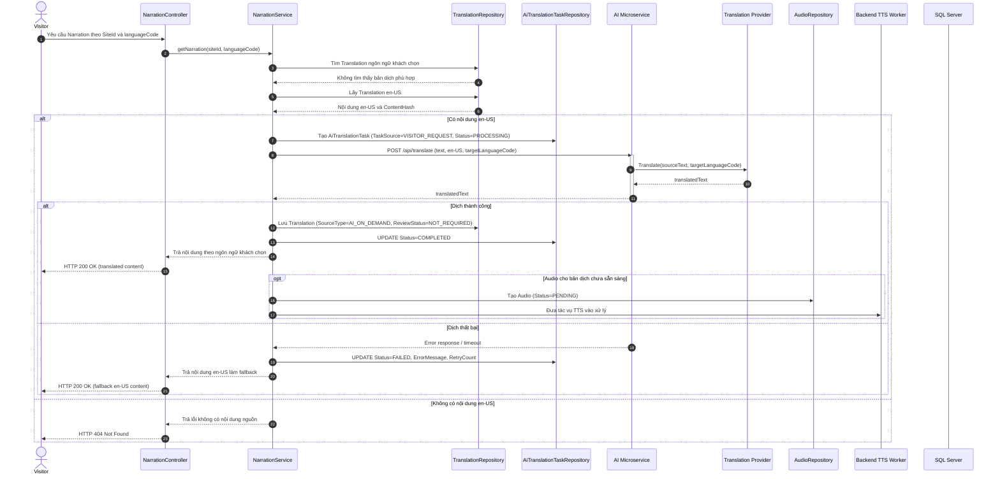
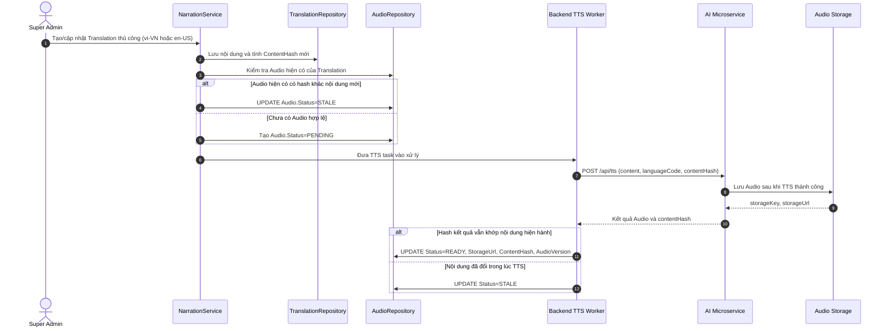

# LinguaFlow AI Sequence Diagram

> **Phiên bản đề xuất:** 2  
> **Trạng thái:** đã được duyệt có thể phát triển thêm trong tương lai
> **Cơ sở:** AI_Microservice_Setup, SRS, BFD, ERD và DataDictionary.  
> **Phạm vi:** Mô tả các luồng Backend điều phối dịch thuật AI, duyệt bản dịch và tạo Audio bằng TTS. AI Microservice chỉ xử lý yêu cầu dịch/TTS; Backend quản lý nghiệp vụ và database.

---

## 1. Quy ước và thành phần

### 1.1. Thành phần tham gia

| Thành phần                                  | Trách nhiệm                                                          |
| ------------------------------------------- | -------------------------------------------------------------------- |
| Super Admin                                 | Nhập nội dung `vi-VN`, `en-US`; xem, chỉnh sửa và duyệt bản dịch AI. |
| Visitor                                     | Yêu cầu nội dung thuyết minh ở ngôn ngữ đã chọn.                     |
| NarrationController / TranslationController | Tiếp nhận request và trả response HTTP.                              |
| NarrationService / TranslationService       | Điều phối nghiệp vụ tạo/cập nhật nội dung và dịch thuật.             |
| TranslationRepository                       | Đọc/ghi bản ghi `Translations`.                                      |
| AiTranslationTaskRepository                 | Đọc/ghi `AiTranslationTasks`.                                        |
| AudioRepository                             | Đọc/ghi trạng thái và metadata của `Audio`.                          |
| Worker                                      | Thực thi các tác vụ dịch/TTS bất đồng bộ do Backend điều phối.       |
| AI Microservice                             | Cung cấp endpoint dịch thuật và TTS qua HTTP.                        |
| Translation Provider                        | Nhà cung cấp dịch thuật được cấu hình trong AI Microservice.         |
| TTS Provider                                | Nhà cung cấp tổng hợp giọng nói được cấu hình trong AI Microservice. |
| Audio Storage                               | Vùng lưu trữ bền vững bên ngoài JAR/WAR của ứng dụng.                |
| SQL Server                                  | Lưu dữ liệu LinguaFlow thông qua Backend.                            |

### 1.2. Nguyên tắc chung

- Mỗi POI có đúng một bản ghi `Narrations`; nội dung theo từng ngôn ngữ được lưu trong `Translations`.
- `vi-VN` và `en-US` do Super Admin biên soạn thủ công.
- AI sử dụng nội dung `en-US` làm nguồn để dịch sang các ngôn ngữ đích.
- `AI_ADMIN` và `AI_ON_DEMAND` là hai nguồn bản dịch có quy trình xử lý khác nhau.
- `AiTranslationTasks` theo dõi tác vụ dịch; `Audio.Status` theo dõi tác vụ TTS. Hai trạng thái độc lập.
- AI Microservice không truy cập trực tiếp SQL Server và không tự cập nhật trạng thái nghiệp vụ.
- Audio chỉ được coi là hợp lệ khi `ContentHash` của Audio khớp với nội dung Translation hiện hành.
- Chỉ tăng `DataVersion` khi dữ liệu thuộc gói POI sync thay đổi; việc tạo Audio hoặc cập nhật trạng thái TTS đơn thuần không tự làm tăng `DataVersion`.

---

## 2. Luồng Admin tạo nội dung và yêu cầu AI dịch

Super Admin nhập nội dung tiếng Việt và tiếng Anh cho Narration của POI. Backend tạo tác vụ dịch cho các ngôn ngữ AI đang được bật trong `SiteLanguages`.

**Quy tắc:**

- Backend lưu nội dung thủ công `vi-VN` và `en-US`; không gọi AI để tạo bản tiếng Anh.
- Chỉ tạo tác vụ cho ngôn ngữ AI được bật tương ứng với POI.
- Mỗi tác vụ dịch gắn với một ngôn ngữ đích để có thể thành công/thất bại độc lập.
- Nếu nội dung `en-US` thay đổi, Backend tính lại hash nguồn và tạo tác vụ dịch phù hợp; kết quả dịch từ hash nguồn cũ không được xem là bản dịch của nội dung mới.
- Các bản dịch AI trong luồng quản trị phải được Super Admin duyệt trước khi xuất bản/sử dụng theo quy trình quản trị.

---

## 3. Luồng Worker dịch thuật AI_ADMIN

Worker lấy từng `AiTranslationTask`, gửi nội dung `en-US` sang AI Microservice và lưu kết quả vào `Translations`. AI Microservice không ghi database.

**Quy tắc:**

- `sourceLanguageCode` luôn là `en-US` đối với bản dịch AI quản trị.
- Bản dịch thành công được lưu với `SourceType=AI_ADMIN` và `ReviewStatus=PENDING`.
- `TaskSource=ADMIN` trong `AiTranslationTasks` không thay thế `SourceType=AI_ADMIN` trong `Translations`; hai trường phục vụ hai mục đích khác nhau.
- Một ngôn ngữ lỗi không được làm mất kết quả thành công của các ngôn ngữ khác.
- Retry có giới hạn theo cấu hình Backend/Resilience4j; không retry vô hạn.
- Không tái sử dụng bản dịch cũ nếu hash nội dung nguồn không khớp.

---

## 4. Luồng Super Admin duyệt bản dịch và kích hoạt TTS

Bản dịch AI quản trị chỉ được đưa vào quy trình TTS sau khi được duyệt. Nội dung thủ công `vi-VN` và `en-US` cũng cần Audio theo yêu cầu hỗ trợ thuyết minh đa ngôn ngữ.

**Quy tắc:**

- Khi Admin duyệt bản dịch AI, Backend mới đưa bản dịch đó vào quy trình TTS.
- Nội dung thủ công `vi-VN` và `en-US` cũng cần được đưa vào quy trình TTS khi nội dung được tạo/cập nhật và đủ điều kiện.
- TTS là tác vụ riêng. TTS thất bại không làm bản dịch chuyển thành `FAILED` hoặc mất trạng thái `APPROVED`.
- `Audio.TranslationId` liên kết với Translation; metadata Audio được lưu trong SQL Server, còn tệp MP3 nằm trong Audio Storage.
- `Audio.Status=READY` chỉ được ghi khi tệp đã lưu thành công và hash vẫn khớp nội dung Translation hiện hành.
- Khi nội dung Translation thay đổi, Audio cũ phải được đánh dấu `STALE` và tạo tác vụ TTS mới theo quy trình Backend.
- Tạo Audio hoặc cập nhật trạng thái TTS không tự làm tăng `DataVersion`.

---

## 5. Luồng khách yêu cầu bản dịch chưa có (AI_ON_DEMAND)

Đây là luồng khác với dịch thuật quản trị. Khi khách chọn ngôn ngữ chưa có bản dịch, Backend có thể yêu cầu dịch ngay từ `en-US`; bản dịch thành công được lưu và trả cho khách mà không chờ Super Admin duyệt.

**Quy tắc:**

- Chỉ dùng luồng này khi khách yêu cầu một ngôn ngữ chưa có bản dịch khả dụng.
- Backend dùng nội dung `en-US` làm nguồn; không dùng `vi-VN` làm nguồn thay thế.
- Khi dịch thành công, Backend lưu `SourceType=AI_ON_DEMAND`, `ReviewStatus=NOT_REQUIRED` và trả nội dung ngay cho khách.
- Khi dịch thất bại, Backend trả nội dung `en-US` làm fallback nếu có.
- Tác vụ TTS của bản dịch on-demand được xử lý riêng và không chặn response nội dung cho khách.
- `TaskSource=VISITOR_REQUEST` trong `AiTranslationTasks` dùng để phân biệt nguồn yêu cầu dịch.
- Nếu nhiều request đồng thời yêu cầu cùng một ngôn ngữ và cùng hash nguồn, Backend nên tránh tạo các tác vụ dịch trùng; cơ chế đồng bộ/idempotency được triển khai ở Backend.
- Lịch sử trò chuyện chatbot không thuộc luồng này và không được gửi lên AI Microservice như một phần mặc định của request dịch.

---

## 6. Luồng TTS cho nội dung thủ công và kiểm tra tính hợp lệ của Audio

Bản dịch thủ công `vi-VN` và `en-US` không cần bước duyệt bản dịch AI, nhưng vẫn cần TTS. Khi nội dung được cập nhật, Backend phải bảo đảm Audio cũ không bị dùng nhầm.

---

## 7. Bảng trạng thái và xử lý lỗi

| Thành phần                   | Trạng thái     | Ý nghĩa                                                                           |
| ---------------------------- | -------------- | --------------------------------------------------------------------------------- |
| `AiTranslationTasks.Status`  | `PENDING`      | Đang chờ Worker xử lý                                                             |
| `AiTranslationTasks.Status`  | `PROCESSING`   | Worker đang gọi dịch vụ dịch thuật                                                |
| `AiTranslationTasks.Status`  | `COMPLETED`    | Kết quả dịch đã được Backend lưu thành công                                       |
| `AiTranslationTasks.Status`  | `FAILED`       | Tác vụ dịch thất bại sau xử lý/retry theo cấu hình                                |
| `Translations.ReviewStatus`  | `PENDING`      | Bản dịch AI quản trị đang chờ Admin duyệt                                         |
| `Translations.ReviewStatus`  | `APPROVED`     | Bản dịch AI quản trị đã được duyệt                                                |
| `Translations.ReviewStatus`  | `REJECTED`     | Bản dịch AI quản trị bị từ chối                                                   |
| `Translations.ReviewStatus`  | `NOT_REQUIRED` | Không cần duyệt, ví dụ nội dung thủ công hoặc AI on-demand theo quy tắc hiện hành |
| `Translations.ContentStatus` | `AVAILABLE`    | Nội dung đang hợp lệ                                                              |
| `Translations.ContentStatus` | `STALE`        | Nội dung không còn khớp nguồn/phiên bản hiện hành                                 |
| `Audio.Status`               | `PENDING`      | Đang chờ tạo Audio                                                                |
| `Audio.Status`               | `PROCESSING`   | TTS đang xử lý                                                                    |
| `Audio.Status`               | `READY`        | Audio đã lưu thành công và hash khớp                                              |
| `Audio.Status`               | `FAILED`       | TTS hoặc lưu trữ thất bại                                                         |
| `Audio.Status`               | `STALE`        | Audio không còn khớp nội dung Translation                                         |

### 7.1. Nguyên tắc lỗi

- Lỗi dịch thuật chỉ cập nhật tác vụ dịch tương ứng; không tự chuyển trạng thái Audio.
- Lỗi TTS chỉ cập nhật `Audio.Status`; không làm mất nội dung Translation đã lưu.
- Lỗi một ngôn ngữ không được làm hỏng kết quả của các ngôn ngữ khác.
- Backend lưu `ErrorMessage` và `RetryCount` phù hợp trong các bảng tương ứng.
- Retry có giới hạn và có timeout; lỗi validation hoặc ngôn ngữ không hỗ trợ không được retry vô hạn.
- Khi nhà cung cấp AI tạm thời không khả dụng, nội dung đã lưu vẫn có thể được phục vụ theo trạng thái hợp lệ; Audio chưa sẵn sàng được xử lý theo fallback/caching đã quy định ở các tài liệu chức năng.

---

## 8. Các điểm cần bảo đảm khi triển khai

- [ ] Không tạo Narration thứ hai cho cùng một POI.
- [ ] Nội dung `vi-VN` và `en-US` do Super Admin biên soạn thủ công.
- [ ] AI dịch các ngôn ngữ đích từ `en-US`.
- [ ] Luồng `AI_ADMIN` có bước Admin review trước khi xuất bản và TTS.
- [ ] Luồng `AI_ON_DEMAND` lưu và trả bản dịch ngay khi thành công; lỗi thì fallback về `en-US`.
- [ ] `TaskSource` và `SourceType` được lưu đúng mục đích, không nhầm lẫn.
- [ ] Translation và Audio có trạng thái độc lập.
- [ ] Audio được lưu ngoài JAR/WAR; SQL Server chỉ lưu metadata/đường dẫn.
- [ ] Kiểm tra `ContentHash` trước khi đánh dấu Audio `READY` hoặc phục vụ Audio.
- [ ] Không tái sử dụng bản dịch/Audio cũ khi hash nguồn không khớp.
- [ ] `DataVersion` chỉ tăng khi dữ liệu thuộc gói POI sync thay đổi.
- [ ] AI Microservice không kết nối trực tiếp SQL Server.
