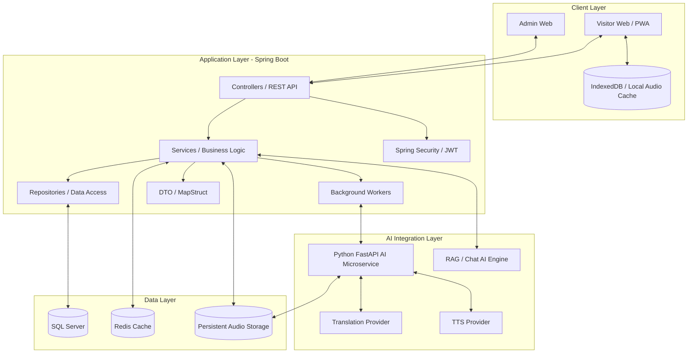
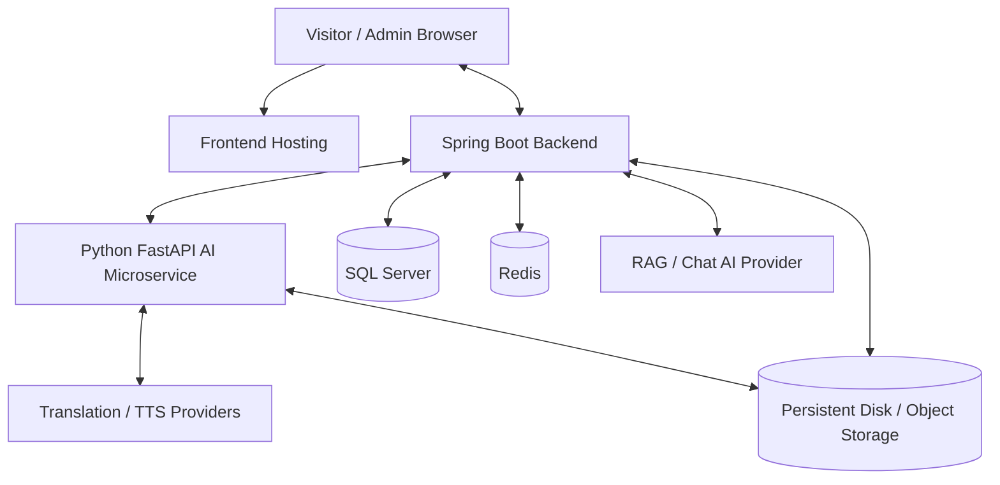

# LINGUAFLOW — ARCHITECTURE & CODING GUIDELINES

> **Phiên bản đề xuất:** ARCHITECTURE  
> **Trạng thái:** đã được duyệt, có thể bổ sung thêm trong tương lai
> **Căn cứ:** PRD, SRS, BFD, ERD, DataDictionary(2), API_Contracts, AI_Microservice_Setup, AI_SequenceDiagram, CACHE_ASIDE_SequenceDiagram.  
> **Mục đích:** Mô tả kiến trúc tổng thể, ranh giới trách nhiệm giữa các thành phần, nguyên tắc triển khai và coding guidelines cho AI Agent/kỹ sư phát triển LinguaFlow.

---

## 1. Tổng quan kiến trúc

LinguaFlow sử dụng kiến trúc Client–Server, với Backend chính được tổ chức theo mô hình 3-Tier. Các dịch vụ chuyên biệt được tách thành tiến trình độc lập khi cần.

### 1.1. Các thành phần chính

| Thành phần               | Công nghệ/định hướng                    | Trách nhiệm                                                                |
| ------------------------ | --------------------------------------- | -------------------------------------------------------------------------- |
| Visitor Web/PWA          | React, TypeScript                       | Bản đồ, lựa chọn ngôn ngữ, QR, phát Audio, Chat AI và trải nghiệm du khách |
| Admin Web                | React, TypeScript                       | Dashboard, quản lý POI, Region, QR, nội dung và cấu hình AI                |
| Spring Boot Backend      | Java, Spring Boot                       | API, nghiệp vụ, xác thực, điều phối AI, truy cập dữ liệu và thống kê       |
| SQL Server               | Relational Database                     | Dữ liệu nghiệp vụ và metadata bền vững                                     |
| Redis                    | Cache                                   | Cache gói POI đồng bộ; không thay thế SQL Server                           |
| Python AI Microservice   | Python, FastAPI                         | Adapter dịch thuật và TTS; không quản lý nghiệp vụ LinguaFlow              |
| Translation Provider     | Nhà cung cấp được cấu hình              | Dịch văn bản                                                               |
| TTS Provider             | Nhà cung cấp được cấu hình              | Sinh Audio từ văn bản                                                      |
| Persistent Audio Storage | Persistent volume hoặc Object Storage   | Lưu tệp Audio bền vững, độc lập vòng đời ứng dụng                          |
| RAG/Chat AI Engine       | Thành phần AI được tích hợp qua Backend | Truy xuất tri thức và tạo câu trả lời Chatbot                              |

**Lưu ý về phạm vi:** AI Microservice trong `AI_Microservice_Setup(2)` chịu trách nhiệm dịch thuật và TTS. Không tự suy luận rằng dịch vụ này đồng thời là Chatbot/RAG Engine. Ranh giới tích hợp, giao thức và nhà cung cấp của Chatbot/RAG cần được mô tả trong tài liệu AI riêng.

### 1.2. Sơ đồ kiến trúc logic



Sơ đồ thể hiện trách nhiệm logic, không khẳng định tất cả thành phần phải chạy trên cùng máy chủ hoặc cùng container.

---

## 2. Kiến trúc Client — React/PWA

### 2.1. Visitor Client

Visitor Client chịu trách nhiệm:

- Hiển thị bản đồ và POI.
- Đồng bộ gói dữ liệu POI cơ bản từ Backend và lưu snapshot vào IndexedDB.
- Lưu lựa chọn ngôn ngữ UI riêng với ngôn ngữ thuyết minh.
- Xác định POI thuộc Geofence dựa trên dữ liệu POI cục bộ.
- Quét QR để xác định POI khi không cấp quyền GPS.
- Khi xác định được Region bằng GPS hoặc QR, yêu cầu Audio Manifest của Region theo ngôn ngữ thuyết minh đã chọn.
- Kiểm tra cache Audio cục bộ và chỉ tải file còn thiếu hoặc không còn đúng phiên bản.
- Phát Audio thông qua một luồng/player được quản lý thống nhất để tránh phát chồng chéo.
- Lưu lịch sử hội thoại cá nhân ở thiết bị; không mặc định đồng bộ toàn bộ lịch sử lên Backend.

### 2.2. Offline-first và cache phía Client

- Gói POI cơ bản được đồng bộ ở lần truy cập đầu tiên.
- Gói POI bao gồm dữ liệu cần cho bản đồ, Geofencing và xác định Region.
- Không tải Audio của mọi Region ngay lần đầu.
- Audio được tải theo Region đã xác định bằng GPS hoặc QR và theo ngôn ngữ thuyết minh đang chọn.
- Dữ liệu cache hợp lệ hiện có phải được giữ lại khi tải mới thất bại.
- Khi đổi ngôn ngữ hoặc Region, chỉ tải Audio thiếu hoặc lỗi phiên bản; tránh tải trùng file còn hợp lệ.
- Không phát Audio cũ có hash không còn khớp nội dung hiện tại.
- Cơ chế lưu cache Audio cụ thể (IndexedDB, Cache API hoặc cơ chế khác) phải được thống nhất trong thiết kế Frontend; không tự giả định công nghệ cache chưa được xác nhận.

### 2.3. Geofencing ở Client

Các phép tính định vị và quyết định kích hoạt Geofence phải thực hiện ở Client dựa trên gói POI cục bộ.

Theo PRD:

- Dùng công thức Haversine để tính khoảng cách.
- Bỏ qua tín hiệu GPS có sai số lớn hơn 150m.
- Áp dụng hysteresis 40m để hạn chế dao động quanh ranh giới.
- Kiểm tra hàng chờ Audio để tránh phát chồng chéo.
- Cooldown 5 phút cho mỗi POI đã phát tự động qua GPS.
- QR hoặc thao tác chọn POI trực tiếp có độ ưu tiên cao hơn GPS.

Backend không nhận tọa độ GPS liên tục để tính khoảng cách hoặc kích hoạt Geofence. Heartbeat GPS phục vụ thống kê phiên GPS hoạt động là một luồng riêng, không phải API định vị Geofence.

### 2.4. Ngôn ngữ

- Ngôn ngữ UI được quản lý bằng các tệp locale phía Client.
- Ngôn ngữ thuyết minh điều khiển việc lấy Translation và Audio.
- Hai lựa chọn này là độc lập, không được gộp thành một biến ngôn ngữ duy nhất.
- Ngôn ngữ phản hồi Chatbot theo ngôn ngữ khách đang chọn cho trải nghiệm nội dung/thuyết minh, không tự động lấy ngôn ngữ UI làm nguồn thay thế.
- Không hardcode văn bản UI trực tiếp trong component nếu nội dung đó thuộc tài nguyên locale.

---

## 3. Kiến trúc Backend — Spring Boot 3-Tier

### 3.1. Controller Layer

Trách nhiệm:

- Nhận HTTP request và kiểm tra dữ liệu đầu vào ở mức cấu trúc.
- Áp dụng validation (`@Valid`) cho request DTO.
- Gọi Service tương ứng.
- Chuyển kết quả Service thành HTTP response.
- Áp dụng cơ chế xác thực/phân quyền theo cấu hình Spring Security.

Không được:

- Chứa nghiệp vụ chính.
- Truy cập Repository trực tiếp.
- Tự gọi AI Provider hoặc AI Microservice.
- Trả trực tiếp JPA Entity ra Frontend.

### 3.2. Service Layer

Trách nhiệm:

- Thực hiện quy tắc nghiệp vụ.
- Điều phối transaction và các Repository.
- Điều phối dịch thuật, TTS, RAG/Chat AI và Storage qua adapter/service tương ứng.
- Kiểm tra trạng thái Translation, Review, ContentHash và Audio.
- Điều phối retry, timeout và xử lý lỗi dịch vụ phụ thuộc.
- Quản lý quy tắc DataVersion và các trạng thái nghiệp vụ.

Service là nơi quyết định một nội dung có đủ điều kiện công bố, tạo TTS hoặc phục vụ Visitor hay không. Không chuyển quyền quyết định nghiệp vụ này sang AI Microservice.

### 3.3. Repository Layer

Trách nhiệm:

- Đọc/ghi dữ liệu SQL Server thông qua Spring Data JPA hoặc cơ chế truy cập dữ liệu đã được dự án phê duyệt.
- Tối ưu truy vấn ở tầng database.
- Không chứa logic nghiệp vụ của Visitor/Admin.
- Không tự gọi Redis, AI Provider hoặc Storage nếu không thuộc adapter được thiết kế riêng.

Các truy vấn lọc, phân trang và tổng hợp cần được thực hiện ở database khi phù hợp; tránh tải toàn bộ bảng về rồi lọc bằng vòng lặp trong Java.

### 3.4. DTO và Mapping

- Mọi dữ liệu trao đổi giữa Frontend và Backend phải qua DTO.
- Không serialize JPA Entity trực tiếp.
- Dùng MapStruct cho mapping Entity/DTO theo coding guideline hiện tại.
- DTO không được để lộ password hash, token nội bộ, API key hoặc các trường persistence không cần thiết.
- Không dùng DTO làm nơi chứa logic nghiệp vụ.

---

## 4. Data Layer và Cache

### 4.1. SQL Server

SQL Server là nguồn dữ liệu bền vững chính của hệ thống, bao gồm:

- Người dùng Super Admin.
- Categories, Regions, Languages.
- TouristSites và SiteLanguages.
- Narrations, Translations, AiTranslationTasks và Audio metadata.
- QR Codes và QR scan logs.
- Visitor Sessions và Audio Listen Logs.
- Cấu hình AI, thống kê tổng hợp và Chat Feedback.

SQL Server chỉ lưu metadata/đường dẫn Audio, không lưu binary MP3.

### 4.2. Redis — Cache Aside cho POI Sync

Endpoint đồng bộ POI ban đầu phải sử dụng cache Redis theo nguyên tắc Cache Aside.

Luồng đọc:

1. Backend xác định `DataVersion` hiện hành.
2. Backend kiểm tra cache key tương ứng với version.
3. Cache hit: trả gói POI đã cache.
4. Cache miss: truy vấn SQL Server, tạo DTO gói POI, ghi cache rồi trả kết quả.
5. Nếu `clientVersion` bằng `serverDataVersion`, trả HTTP 304 Not Modified.

Quy tắc:

- Redis chỉ là cache; SQL Server vẫn là nguồn dữ liệu chuẩn.
- Cache key phải gắn với `DataVersion`, ví dụ `poi-package:{version}`.
- Khi dữ liệu thuộc phạm vi gói POI thay đổi, tăng DataVersion và bảo đảm cache version mới được tạo/đọc đúng.
- Không trả cache của version cũ như thể đó là version hiện tại.
- Redis lỗi không được làm mất dữ liệu bền vững; cần chính sách fallback truy vấn SQL Server hoặc trả lỗi có kiểm soát.
- Không dùng Redis làm nơi lưu lịch sử hội thoại cá nhân hoặc làm nguồn dữ liệu duy nhất.

### 4.3. Phân biệt các phiên bản

Không gộp mọi loại version thành một biến:

- `DataVersion`: phiên bản gói POI sync.
- `ContentVersion`/`ContentHash`: phiên bản và định danh nội dung Translation.
- `AudioVersion`/`Audio.ContentHash`: phiên bản Audio và nội dung mà file được tạo từ đó.

TTS hoàn thành hoặc Audio đổi trạng thái không tự làm tăng `DataVersion` nếu gói POI sync không thay đổi.

---

## 5. AI Integration Architecture

### 5.1. Spring Boot là nơi điều phối nghiệp vụ

Spring Boot Backend:

- Chọn Translation nguồn và ngôn ngữ đích.
- Kiểm tra ngôn ngữ được bật cho POI.
- Tạo và quản lý `AiTranslationTasks`.
- Quản lý trạng thái duyệt của Translation.
- Quyết định khi nào được đưa TTS vào hàng đợi.
- Quản lý Audio metadata, hash, version và trạng thái.
- Thực hiện retry/timeout khi gọi dịch vụ AI.
- Không cho AI Microservice truy cập trực tiếp SQL Server.

### 5.2. Python AI Microservice

AI Microservice chạy độc lập bằng Python/FastAPI và cung cấp adapter cho:

- Dịch thuật.
- Text-to-Speech.

AI Microservice:

- Nhận request đã được Backend kiểm tra.
- Gọi provider tương ứng.
- Trả kết quả hoặc lỗi có cấu trúc.
- Lưu Audio vào Persistent Storage thông qua Storage Adapter khi xử lý TTS.
- Không tự duyệt bản dịch.
- Không tự quản lý SiteLanguages.
- Không tự cập nhật DataVersion.
- Không lưu toàn bộ lịch sử Chat của Visitor.
- Không tự ghi dữ liệu nghiệp vụ vào SQL Server.

Spring Boot và AI Microservice là hai tiến trình/dịch vụ riêng. Base URL nội bộ phải lấy từ cấu hình môi trường, không hardcode `localhost` trong môi trường triển khai nhiều máy/container.

### 5.3. Dịch thuật và TTS bất đồng bộ

- Dịch thuật quản trị và TTS phải được xử lý nền.
- API nhận yêu cầu xử lý nền trả `202 Accepted` cùng mã task hoặc trạng thái để Client theo dõi.
- Không giữ HTTP request của Admin/Visitor chờ TTS hoàn tất.
- Dịch thuật quản trị tạo Translation chờ Super Admin duyệt.
- Dịch on-demand của Visitor là luồng riêng: khi thành công có thể trả ngay nội dung dịch cho Visitor theo SRS; tác vụ TTS vẫn chạy nền.
- TTS chỉ được tạo cho nội dung đủ điều kiện theo quy trình tương ứng.
- Trạng thái Translation và Audio độc lập.

### 5.4. Retry, Timeout và Idempotency

Khi Backend gọi AI Microservice/provider:

- Bắt buộc dùng Resilience4j CircuitBreaker và Retry theo coding guideline.
- Cấu hình timeout riêng cho dịch thuật và TTS.
- Chỉ retry lỗi tạm thời như timeout, lỗi kết nối hoặc lỗi upstream có thể phục hồi.
- Không retry vô hạn lỗi validation hoặc ngôn ngữ không hỗ trợ.
- TTS cần có tính idempotent dựa trên `contentHash`, `languageCode` và cấu hình giọng đọc để tránh tạo file trùng.
- Khi hết số lần retry, cập nhật trạng thái task/Audio thành `FAILED`, lưu thông tin lỗi phù hợp và cho phép thử lại theo nghiệp vụ.
- Không trả thành công giả khi provider hoặc Storage thất bại.

### 5.5. Chatbot và RAG

- Chatbot/RAG được gọi qua Backend; Frontend không gọi trực tiếp AI Provider.
- Backend chuẩn bị câu hỏi, ngôn ngữ phản hồi và context địa điểm/Region nếu có.
- Ngôn ngữ phản hồi phải theo ngôn ngữ khách đang chọn cho nội dung thuyết minh/Chatbot; không nhầm với locale UI.
- Context vị trí có thể là POI/Region hiện tại hoặc tọa độ nếu thật sự cần thiết và có sẵn.
- Không cần gửi tọa độ GPS liên tục để phục vụ RAG.
- Knowledge Base được cập nhật từ dữ liệu POI và nội dung thuyết minh đã đủ điều kiện theo SRS.
- Đồng bộ Knowledge Base không đồng nghĩa với huấn luyện lại mô hình.
- Lịch sử hội thoại cá nhân lưu cục bộ; Server chỉ lưu thống kê tổng hợp và đoạn hội thoại khách chủ động gửi phản hồi.
- Tài liệu tích hợp Chatbot/RAG phải xác định rõ endpoint, provider, timeout, dữ liệu context và chính sách lỗi; không tự gán các chức năng này cho AI Microservice dịch/TTS nếu chưa có hợp đồng tương ứng.

---

## 6. Audio Storage Architecture

### 6.1. Nguyên tắc lưu trữ

- Audio phải nằm trong vùng lưu trữ bền vững, độc lập vòng đời triển khai Spring Boot và AI Microservice.
- Không lưu file MP3 bên trong JAR/WAR hoặc thư mục source/build artifact.
- Có thể dùng persistent volume hoặc Object Storage; chưa khóa vào nhà cung cấp cụ thể.
- SQL Server chỉ lưu `StorageUrl`/định danh lưu trữ, trạng thái, hash, version và metadata liên quan.
- Storage Adapter chịu trách nhiệm ghi/đọc/xác minh file.
- URL nội bộ giữa Backend và AI Microservice không đồng nhất với URL mà Browser dùng để tải Audio.

### 6.2. Định danh và tính nhất quán Audio

- File Audio phải được liên kết với đúng Translation.
- Audio chỉ được xem là hợp lệ khi trạng thái `READY` và `ContentHash` khớp nội dung Translation hiện hành.
- Khi nội dung thay đổi, Audio cũ phải được đánh dấu `STALE` hoặc không còn được phục vụ.
- Client không phát Audio stale, Audio sai ngôn ngữ hoặc Audio thuộc POI/Region khác.
- Đường dẫn có thể được tạo dựa trên Site, locale và content hash; đây là quy ước triển khai, không phải yêu cầu bắt buộc về cấu trúc URL.

---

## 7. Security Architecture

### 7.1. Admin Authentication

- Chỉ có một tài khoản Super Admin theo PRD.
- Spring Security bảo vệ toàn bộ Admin API.
- JWT dùng để xác thực request; Backend kiểm tra trạng thái tài khoản và thời gian không hoạt động.
- Inactivity timeout 30 phút phải được kiểm tra phía Server.
- Khóa đăng nhập tạm thời 15 phút sau hơn 5 lần đăng nhập sai liên tiếp theo SRS.
- Mật khẩu lưu dạng BCrypt hash.
- Không có API đăng ký tài khoản hoặc quên mật khẩu qua email.

### 7.2. Public/Visitor API

- Chỉ công khai các endpoint cần thiết cho Visitor.
- Không để lộ Admin API, thông tin cấu hình bí mật hoặc dữ liệu nội bộ.
- Có thể áp dụng rate limiting cho endpoint public theo chính sách triển khai.
- Session Visitor là ẩn danh, phục vụ thống kê; không suy diễn thành danh tính thật.
- Không lưu toàn bộ lịch sử Chat của Visitor trên Server theo mặc định.

### 7.3. Secrets và cấu hình

- API key, credentials Storage, JWT secret và thông tin kết nối database phải lấy từ biến môi trường hoặc Secret Manager.
- Không hardcode secret trong source code.
- Không commit `.env` chứa secret.
- Repository chỉ chứa `.env.example` với giá trị placeholder.
- Phân biệt cấu hình local, staging và production.
- Không ghi token, password, API key hoặc nội dung hội thoại cá nhân vào log.

---

## 8. Deployment Architecture

### 8.1. Các tiến trình triển khai

Tối thiểu cần phân biệt:

1. Frontend static hosting/web server.
2. Spring Boot Backend.
3. Python AI Microservice.
4. SQL Server.
5. Redis.
6. Persistent Audio Storage hoặc Object Storage.
7. Các nhà cung cấp AI bên ngoài.

Các thành phần có thể nằm trên cùng máy trong môi trường demo hoặc tách ra nhiều dịch vụ khi triển khai thật. Dù bố trí thế nào, ranh giới trách nhiệm và luồng kết nối vẫn phải được giữ.

### 8.2. Sơ đồ triển khai logic



Sơ đồ không khóa nhà cung cấp hosting hoặc Storage. Việc chọn nhà cung cấp phải dựa trên giới hạn miễn phí, độ bền dữ liệu, băng thông, bảo mật và khả năng triển khai thực tế.

### 8.3. Cấu hình môi trường

Ví dụ tên biến cấu hình (giá trị chỉ là placeholder):

```dotenv
SPRING_DATASOURCE_URL=
SPRING_DATASOURCE_USERNAME=
SPRING_DATASOURCE_PASSWORD=

REDIS_HOST=
REDIS_PORT=

AI_SERVICE_BASE_URL=
AI_SERVICE_API_KEY=

AUDIO_STORAGE_PROVIDER=
AUDIO_STORAGE_ROOT=
AUDIO_PUBLIC_BASE_URL=

JWT_SECRET=
```

Không sử dụng các giá trị trên làm secret thật trong tài liệu hoặc source code. Không hardcode `localhost` cho kết nối giữa các dịch vụ khi deploy trên nhiều container/máy.

---

## 9. Library Governance — Quy tắc sử dụng thư viện

Không tự ý thêm dependency ngoài vào `pom.xml` chỉ để giải quyết logic nghiệp vụ nếu chưa được cho phép hoặc chưa được thống nhất trong dự án.

| Layer/Chức năng | Quy tắc                                                                                                                          |
| --------------- | -------------------------------------------------------------------------------------------------------------------------------- |
| Controller      | Dùng `spring-boot-starter-webmvc` và `@Valid`; không tự serialize JSON bằng `ObjectMapper` thủ công                              |
| Service         | Logic nghiệp vụ lõi ưu tiên Java/Spring; gọi AI bên ngoài phải dùng Resilience4j CircuitBreaker/Retry                            |
| Repository      | Dùng Spring Data JPA/`@Query` phù hợp; truy vấn lọc và phân trang ở database, không tải toàn bộ dữ liệu về rồi lọc bằng vòng lặp |
| Migration       | Dùng `flyway-core` để quản lý thay đổi schema                                                                                    |
| Cache           | Dùng `spring-boot-starter-data-redis` cho POI Sync                                                                               |
| DTO Mapping     | Dùng MapStruct; không trả Entity trực tiếp                                                                                       |
| Validation      | Dùng Jakarta Bean Validation qua `@Valid`                                                                                        |
| Security        | Dùng Spring Security; JWT phải được kiểm tra ở Backend                                                                           |
| AI Microservice | Quản lý dependency Python trong `requirements.txt`/công cụ quản lý dependency của dự án; không trộn dependency Python vào Maven  |

Nếu cần thêm thư viện, phải nêu rõ:

- Vấn đề kỹ thuật cần giải quyết.
- Vì sao thư viện hiện có không đáp ứng.
- Dependency và version đề xuất.
- Ảnh hưởng bảo mật, hiệu năng và khả năng triển khai.
- Chờ phê duyệt trước khi thêm vào dự án.

---

## 10. Coding Standards — Java/Spring Boot

Các quy tắc sau giữ lại từ tài liệu gốc:

1. **Java Text Blocks:** Các câu truy vấn `@Query` sử dụng Java Text Blocks (`""" ... """`) theo coding guideline của dự án; không nối chuỗi query thủ công.
2. **Type Inference:** Ưu tiên `var` cho biến cục bộ khi kiểu được suy luận rõ ràng và giúp code dễ đọc.
3. **Optional Handling:** Không gọi `Optional.get()`; dùng `orElseThrow()`, `ifPresent()`, `map()` hoặc cách xử lý tường minh phù hợp.
4. **Layering:** Controller → Service → Repository; không bỏ qua tầng.
5. **DTO:** Request/Response dùng DTO; không expose Entity.
6. **Transactions:** Các thao tác cập nhật nhiều bảng cần xác định ranh giới transaction rõ ràng.
7. **Error Handling:** Dùng cơ chế xử lý lỗi tập trung (`@RestControllerAdvice` hoặc giải pháp tương đương đã thống nhất); không trả stack trace cho Client.
8. **Logging:** Log theo mức độ phù hợp, không ghi secrets hoặc toàn bộ Chat history.
9. **Configuration:** Dùng `@ConfigurationProperties` hoặc cơ chế cấu hình thống nhất; không rải hardcoded URL/secret trong Service.
10. **Testing:** Kiểm thử Service/Repository/API; các luồng bất đồng bộ, cache miss/hit, retry và stale Audio cần có test tương ứng.

---

## 11. Coding Standards — React/TypeScript

1. Tách API client khỏi UI component.
2. Dùng TypeScript types/interfaces cho DTO tương ứng API Contracts.
3. Không gọi AI Microservice hoặc AI Provider trực tiếp từ Browser.
4. Tách trạng thái ngôn ngữ UI và ngôn ngữ thuyết minh.
5. Geofencing chạy phía Client dựa trên snapshot POI cục bộ.
6. Tách logic GPS, QR, audio queue, cooldown và audio player khỏi component hiển thị khi phù hợp.
7. Cache POI/Audio phải kiểm tra version/hash; không phát file stale.
8. Xử lý quyền GPS bị từ chối hoặc mất tín hiệu mà không làm hỏng luồng QR.
9. Không lưu lịch sử Chat cá nhân lên Backend theo mặc định.
10. Xử lý loading, empty, offline, retry và lỗi API rõ ràng; không giả định request luôn thành công.

---

## 12. Observability và xử lý lỗi

- Backend cần log có cấu trúc cho request, task dịch, task TTS, cache hit/miss và lỗi tích hợp.
- Không log password, JWT secret, API key, nội dung hội thoại đầy đủ hoặc dữ liệu cá nhân không cần thiết.
- Các task AI phải có trạng thái và thông tin lỗi đủ để Super Admin/Backend xác định việc retry.
- Timeout phải được cấu hình cho dịch vụ bên ngoài; không để request treo vô hạn.
- Redis lỗi phải có hành vi fallback được định nghĩa.
- Storage lỗi không được đánh dấu Audio `READY`.
- Provider AI lỗi không được ghi Translation/Audio giả thành công.
- Health check của từng service cần phân biệt trạng thái ứng dụng với trạng thái phụ thuộc (DB, Redis, AI Provider, Storage).

---

## 13. Nguyên tắc không được vi phạm

1. Không đưa logic nghiệp vụ vào Controller.
2. Không trả JPA Entity trực tiếp cho Frontend.
3. Không để Frontend gọi trực tiếp AI Provider hoặc AI Microservice.
4. Không để AI Microservice truy cập trực tiếp SQL Server.
5. Không chạy dịch thuật/TTS đồng bộ trong request của người dùng.
6. Không tính Geofence ở Backend hoặc gửi GPS liên tục để Backend tính khoảng cách.
7. Không tải Audio toàn bộ Region ngay trong gói POI ban đầu.
8. Không lưu MP3 bên trong JAR/WAR hoặc SQL Server.
9. Không phát Audio stale hoặc sai ngôn ngữ.
10. Không dùng `DataVersion` thay thế `ContentVersion`/`AudioVersion`.
11. Không lưu toàn bộ lịch sử Chat của Visitor trên Server theo mặc định.
12. Không để Redis thay thế SQL Server làm nguồn dữ liệu chuẩn.
13. Không hardcode secrets hoặc endpoint triển khai trong source code.
14. Không tự ý thêm dependency chưa được phê duyệt.

---

## 14. Các điểm cần thống nhất trước khi triển khai chi tiết

Đây là các quyết định kỹ thuật chưa được khóa chỉ bởi tài liệu kiến trúc này:

1. Công nghệ cache Audio phía Browser: IndexedDB, Cache API, Service Worker hay kết hợp.
2. Công nghệ/nhà cung cấp Persistent Audio Storage.
3. Nhà cung cấp và hợp đồng tích hợp cụ thể của RAG/Chat AI Engine.
4. Cơ chế queue/background worker: Spring `@Async`, scheduler, database-backed queue hay Message Broker. Dù chọn cách nào, phải bảo đảm task có trạng thái bền vững và xử lý retry phù hợp.
5. Cơ chế cấp URL Audio: public URL, signed URL hay Backend proxy.
6. Mô hình deploy demo và production; cấu hình network giữa Backend, AI Microservice, SQL Server, Redis và Storage.
7. Chiến lược backup/restore SQL Server và Audio Storage.

Không tự quyết định các mục trên bằng cách thêm công nghệ vào code nếu chưa được người phụ trách dự án phê duyệt.

---

## 15. Checklist kiểm tra kiến trúc

- [ ] Frontend và Backend giao tiếp qua API Contracts, dùng DTO.
- [ ] Backend tuân thủ Controller → Service → Repository.
- [ ] Geofencing và lọc nhiễu GPS chạy ở Client.
- [ ] POI Sync dùng Redis Cache Aside và hỗ trợ HTTP 304.
- [ ] POI snapshot có Region metadata.
- [ ] Audio chỉ tải theo Region đã xác định và ngôn ngữ thuyết minh.
- [ ] QR hoạt động độc lập với quyền GPS.
- [ ] Spring Boot điều phối dịch thuật/TTS; AI Microservice chỉ thực hiện tác vụ AI được giao.
- [ ] Tác vụ AI chạy bất đồng bộ, có retry/timeout và trạng thái.
- [ ] Audio lưu ở Storage bền vững ngoài vòng đời ứng dụng.
- [ ] Translation/Audio hash và version được kiểm tra trước khi phát.
- [ ] Chatbot dùng context cần thiết và trả lời theo ngôn ngữ thuyết minh đã chọn.
- [ ] UI locale tách biệt với narration locale.
- [ ] Visitor chat history lưu cục bộ; Server chỉ lưu thống kê và feedback tự nguyện.
- [ ] Admin API được bảo vệ bằng Spring Security/JWT và inactivity timeout phía Server.
- [ ] Secrets được cấu hình qua môi trường/Secret Manager.
- [ ] Dependency mới phải được xem xét và phê duyệt.
