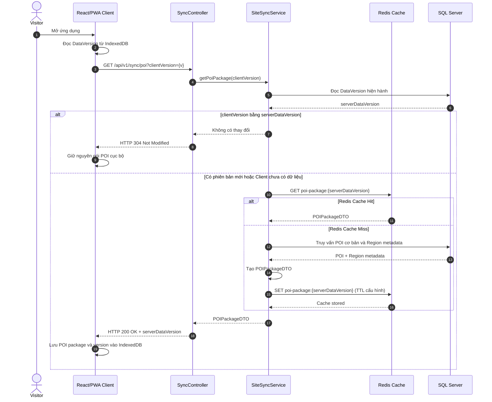
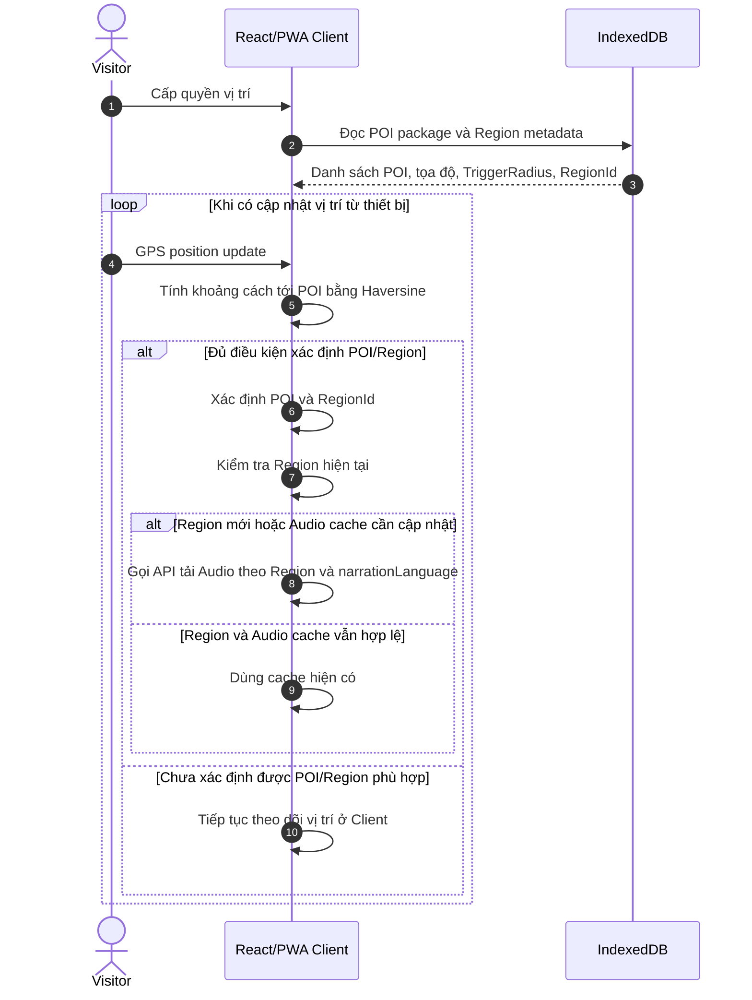
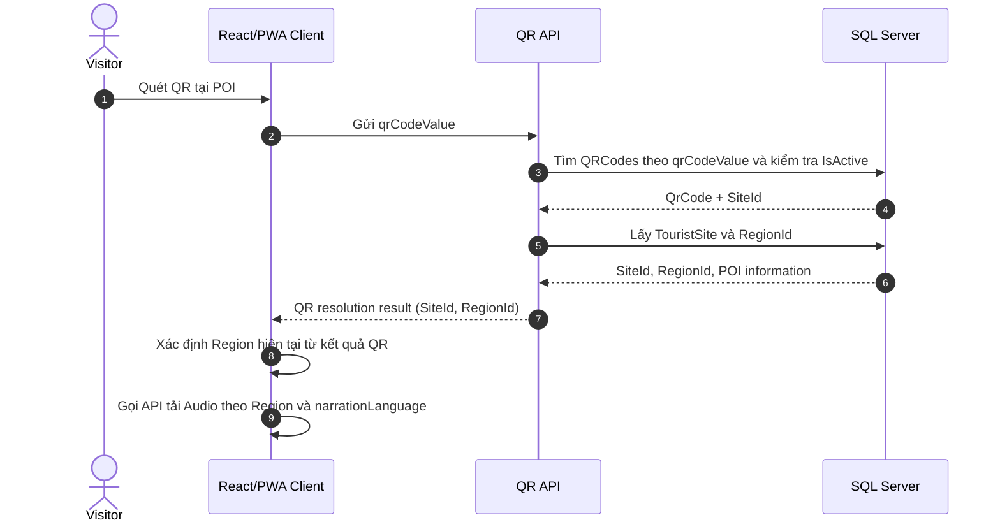
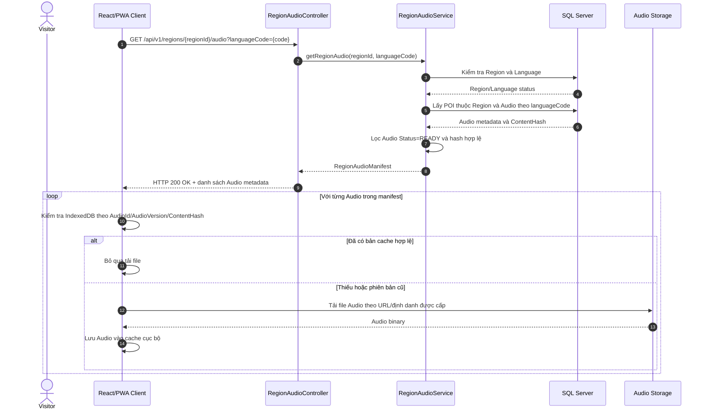
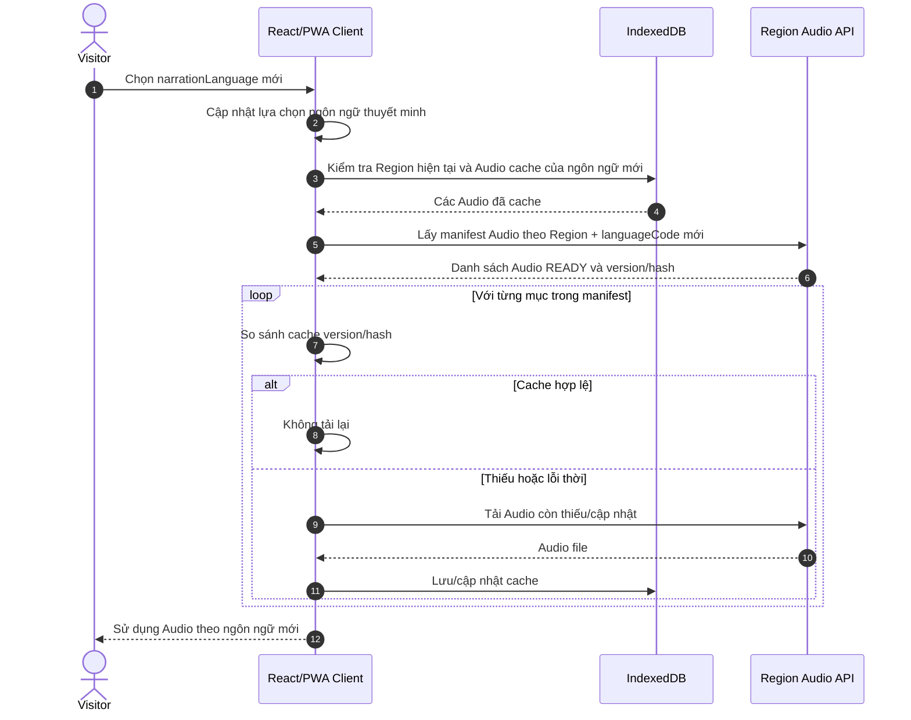

# LinguaFlow Cache Aside Sequence Diagram

> **Phiên bản đề xuất:** 2  
> **Trạng thái:** Bản đề xuất để review.  
> **Cơ sở:** PRD, SRS, BFD, ERD, DataDictionary, AI_Microservice_Setup và AI_SequenceDiagram.  
> **Phạm vi:** Đồng bộ dữ liệu POI ban đầu, Cache Aside ở Backend, xác định Region bằng GPS/QR và tải Audio theo Region/ngôn ngữ thuyết minh.

---

## 1. Mục tiêu và nguyên tắc

Tài liệu mô tả hai quá trình liên quan nhưng tách biệt:

1. **Đồng bộ gói POI ban đầu:** Client lấy dữ liệu POI cơ bản và metadata Region cần thiết để hoạt động offline. Không tải Audio của tất cả POI trong bước này.
2. **Tải Audio theo Region:** Khi Client xác định được Region hiện tại bằng GPS hoặc QR, Client yêu cầu danh sách Audio thuộc Region đó theo ngôn ngữ thuyết minh đã chọn, sau đó chỉ tải các tệp còn thiếu hoặc lỗi thời.

Nguyên tắc:

- Geofencing và tính khoảng cách GPS được thực hiện ở Client dựa trên dữ liệu POI đã đồng bộ.
- Backend cung cấp dữ liệu và quản lý cache phía server; Client quản lý cache POI/Audio phía thiết bị.
- QR xác định POI; từ POI đó Client/Backend xác định Region tương ứng.
- Không tải Audio của tất cả Region ngay khi khách mở ứng dụng.
- Không tải lại Audio đã có và còn hợp lệ trong cache cục bộ.
- Ngôn ngữ giao diện và ngôn ngữ thuyết minh là hai lựa chọn độc lập.
- Không gửi tọa độ GPS liên tục lên Backend chỉ để tính Geofencing.
- `DataVersion` chỉ thay đổi khi dữ liệu thuộc gói POI sync thay đổi theo quy tắc PRD.

---

## 2. Thành phần tham gia

| Thành phần            | Trách nhiệm                                                                       |
| --------------------- | --------------------------------------------------------------------------------- |
| Visitor               | Sử dụng ứng dụng; cấp quyền GPS nếu muốn dùng định vị.                            |
| React/PWA Client      | Gọi API, lưu POI và Audio cache, tính Geofencing, xác định Region từ GPS hoặc QR. |
| SyncController        | Tiếp nhận yêu cầu đồng bộ gói POI.                                                |
| SiteSyncService       | Điều phối lấy gói POI và kiểm tra DataVersion.                                    |
| Redis Cache           | Lưu bản cache của gói POI sync và metadata cần thiết.                             |
| RegionAudioController | Tiếp nhận yêu cầu lấy danh sách Audio theo Region/ngôn ngữ.                       |
| RegionAudioService    | Kiểm tra Region/ngôn ngữ, lấy danh sách Audio hợp lệ.                             |
| SQL Server            | Lưu POI, Region, Translation, Audio và metadata đồng bộ.                          |
| Audio Storage         | Lưu tệp MP3 bền vững bên ngoài JAR/WAR.                                           |
| QR API / QR lookup    | Xác định POI từ mã QR; không tự suy ra vị trí GPS.                                |

---

## 3. Luồng đồng bộ gói POI ban đầu (Cache Aside)

Client gửi `clientVersion` hiện có. Backend so sánh với `DataVersion` hiện hành. Nếu bằng nhau, trả HTTP 304; nếu khác, Backend trả gói POI cơ bản. Redis được dùng theo Cache Aside để giảm truy vấn database.

### 3.1. Phạm vi dữ liệu gói POI ban đầu

Gói đồng bộ ban đầu cần đủ dữ liệu để Client hiển thị POI và thực hiện Geofencing offline, ví dụ:

- `siteId`
- Tên POI
- `categoryId`
- `regionId`
- Mô tả/thông tin cơ bản cần cho giao diện
- `latitude`, `longitude`
- `triggerRadius`
- `imageUrl` hoặc thông tin ảnh cần thiết
- `serverDataVersion`

Không đưa danh sách toàn bộ `translations` và `audioUrl` vào gói POI ban đầu. Nội dung thuyết minh và Audio được lấy theo luồng riêng phù hợp với Region và ngôn ngữ thuyết minh.

### 3.2. Quy tắc Cache Aside

1. Backend xác định `serverDataVersion` hiện hành.
2. Nếu Client đã có đúng version, trả `304 Not Modified` và không cần dựng lại gói dữ liệu.
3. Nếu cần gói mới, Backend đọc cache theo version.
4. Cache miss thì truy vấn SQL Server, tạo DTO và ghi cache.
5. Cache hit thì dùng DTO trong Redis để trả về Client.
6. Khi dữ liệu thuộc gói POI sync thay đổi, Backend cập nhật `DataVersion`; cache của version cũ không được dùng làm gói mới.

TTL là cấu hình vận hành, không phải quy tắc nghiệp vụ cố định. Có thể xóa cache cũ theo chính sách dọn dẹp.

---

## 4. Luồng xác định Region bằng GPS ở Client

GPS được dùng tại Client để xác định Region/POI dựa trên dữ liệu đã đồng bộ. Không cần gửi vị trí liên tục lên Backend chỉ để tính khoảng cách.

**Lưu ý:** Chu kỳ nhận cập nhật GPS do thiết bị/trình duyệt và cấu hình ứng dụng quyết định. Không đóng đinh chu kỳ ba giây như một yêu cầu bắt buộc.

---

## 5. Luồng xác định Region bằng QR khi không dùng GPS

QR là một phương thức độc lập để xác định POI và Region. Khách không cần cấp quyền GPS nếu quét QR thành công.

Quy tắc:

- QR không yêu cầu GPS để nhận diện POI.
- QR không hợp lệ hoặc đã vô hiệu hóa phải trả lỗi phù hợp.
- Region được suy ra từ POI gắn với QR.
- Sau khi có `RegionId`, Client dùng cùng luồng tải Audio theo Region như trường hợp GPS.

---

## 6. Luồng lấy danh sách Audio theo Region và ngôn ngữ thuyết minh

Client gọi API riêng sau khi xác định Region. Backend chỉ trả các Audio đã sẵn sàng, hợp lệ và thuộc Region/ngôn ngữ được yêu cầu.

### 6.1. Quy tắc manifest Audio

Mỗi mục Audio trong manifest nên cung cấp đủ thông tin để Client kiểm tra cache, ví dụ:

- `audioId`
- `siteId`
- `languageCode`
- `audioVersion`
- `contentHash`
- `audioUrl` hoặc URL truy cập có thời hạn
- `fileSize` nếu Backend có thể cung cấp

Chỉ đưa Audio `READY` và còn khớp với Translation hiện hành vào manifest. Audio `PENDING`, `PROCESSING`, `FAILED` hoặc `STALE` không được xem là Audio sẵn sàng để tải.

### 6.2. Không đồng nhất URL với định danh lưu trữ

Nếu Storage sử dụng URL ký có thời hạn, Client không được dùng URL đó làm khóa duy nhất để nhận diện file đã cache. Dùng `audioId`, `audioVersion` và/hoặc `contentHash` để kiểm tra phiên bản; Backend cấp URL tải phù hợp khi cần.

---

## 7. Luồng đổi ngôn ngữ thuyết minh hoặc chuyển Region

Ngôn ngữ giao diện không quyết định ngôn ngữ Audio. Khi khách đổi narration language, Client giữ POI cache hiện có và tải Audio của Region hiện tại theo ngôn ngữ mới.

Khi Region thay đổi:

- Client giữ cache các Region đã tải, trừ khi chính sách dung lượng yêu cầu dọn dẹp.
- Client yêu cầu manifest cho Region mới và narration language hiện tại.
- Chỉ tải Audio thiếu hoặc lỗi thời.
- Không tải Audio của các Region khác nếu khách chưa xác định/đi vào Region đó.

---

## 8. Xử lý lỗi và khả năng phục hồi

| Tình huống                                | Hành vi mong muốn                                                                                                               |
| ----------------------------------------- | ------------------------------------------------------------------------------------------------------------------------------- |
| Redis cache miss                          | Backend truy vấn SQL Server, tạo DTO và ghi Redis.                                                                              |
| Redis không khả dụng                      | Backend có thể truy vấn SQL Server trực tiếp; cache không được làm ứng dụng ngừng hoạt động.                                    |
| `clientVersion` trùng `serverDataVersion` | Trả HTTP 304 Not Modified.                                                                                                      |
| Không có GPS permission                   | Khách vẫn có thể xác định Region bằng QR.                                                                                       |
| QR không hợp lệ/vô hiệu hóa               | Trả lỗi phù hợp; không tự suy đoán Region.                                                                                      |
| Không có Audio READY cho ngôn ngữ chọn    | Backend trả manifest không có Audio tương ứng hoặc trạng thái phù hợp; Client áp dụng fallback nội dung/Audio theo quy tắc SRS. |
| Mất mạng khi tải Audio                    | Giữ các file cache hợp lệ; tải lại phần còn thiếu khi kết nối phục hồi.                                                         |
| Tải file thất bại giữa chừng              | Không đánh dấu file là cache hợp lệ; retry khi phù hợp.                                                                         |
| Audio version/hash thay đổi               | Tải phiên bản mới; không phát file cũ như nội dung mới.                                                                         |
| Đổi ngôn ngữ                              | Chỉ tải Audio còn thiếu/lỗi thời của Region hiện tại theo ngôn ngữ mới.                                                         |
| Chuyển Region                             | Lấy manifest Region mới; không tải toàn bộ các Region khác.                                                                     |

### 8.1. Fallback nội dung và Audio

- Nếu khách yêu cầu ngôn ngữ chưa có bản dịch, Backend thực hiện luồng `AI_ON_DEMAND` như `AI_SequenceDiagram(2)`.
- Nếu dịch thành công, Backend trả nội dung ngôn ngữ được yêu cầu.
- Nếu dịch thất bại, Backend trả nội dung `en-US` nếu có.
- Nếu Audio ngôn ngữ đã chọn chưa sẵn sàng, áp dụng quy tắc fallback Audio được mô tả trong SRS; không giả định rằng bản dịch thành công đồng nghĩa Audio đã sẵn sàng.
- Nếu Audio fallback cũng chưa có, Client không được phát một Audio cũ hoặc Audio sai ngôn ngữ; cần thể hiện trạng thái chưa sẵn sàng và tiếp tục retry theo chính sách.

---

## 9. Quy tắc DataVersion và Cache Invalidation

`DataVersion` phục vụ gói POI sync ban đầu, không phải phiên bản của mọi tài nguyên trong hệ thống.

- Tăng `DataVersion` khi dữ liệu thuộc gói POI sync thay đổi, theo PRD.
- Thay đổi tọa độ, bán kính kích hoạt, tên/mô tả cơ bản, ảnh hoặc Region association của POI cần được xem xét theo phạm vi gói sync.
- Tạo Audio, đổi trạng thái TTS hoặc thay đổi metadata lưu trữ Audio đơn thuần không tự làm tăng `DataVersion`.
- Nếu nội dung Translation được đồng bộ trong một gói dữ liệu riêng, cần quản lý version/manifest riêng cho gói đó; không tự mở rộng phạm vi `DataVersion` của POI sync.
- Cache Redis phải gắn với version của gói POI; không trả cache cũ như dữ liệu mới.
- Client dùng `DataVersion` để quyết định đồng bộ lại POI; dùng `audioVersion`/`contentHash` để kiểm tra Audio.

---

## 10. Checklist triển khai

- [ ] Gói POI ban đầu chứa dữ liệu POI cơ bản và Region metadata cần thiết.
- [ ] Không nhúng toàn bộ Translation/Audio vào gói POI sync ban đầu.
- [ ] Backend trả 304 khi `clientVersion` bằng `serverDataVersion`.
- [ ] Cache Aside dùng key gắn với `DataVersion`.
- [ ] Cache Redis lỗi không làm hệ thống ngừng phục vụ; có thể fallback truy vấn DB.
- [ ] Geofencing được tính ở Client, không gửi GPS liên tục lên Backend.
- [ ] GPS có thể xác định Region; QR có thể xác định POI rồi suy ra Region mà không cần GPS.
- [ ] Audio manifest được lọc theo Region và narration language.
- [ ] Chỉ tải Audio `READY`, hash hợp lệ.
- [ ] Client chỉ tải Audio thiếu hoặc lỗi thời.
- [ ] Cache Audio được nhận diện bằng ID/version/hash, không phụ thuộc URL ký có thời hạn.
- [ ] Đổi ngôn ngữ chỉ tải Audio của Region hiện tại theo ngôn ngữ mới.
- [ ] Chuyển Region không kích hoạt tải Audio của mọi Region.
- [ ] Mất mạng không xóa các cache Audio đang hợp lệ.
- [ ] `DataVersion` không tăng chỉ vì TTS hoàn thành hoặc trạng thái Audio thay đổi.
